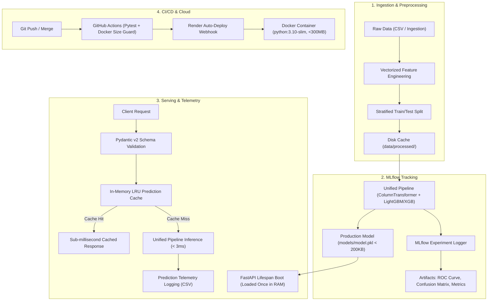

# Customer Churn Prediction — End-to-End MLOps Pipeline

[](https://github.com/mohanasanthibattula-stack/churn-mlops/actions)
[](https://www.python.org/)
[](https://fastapi.tiangolo.com)
[](https://www.docker.com/)
[](https://render.com)
[](https://opensource.org/licenses/MIT)

> A production-grade, low-latency machine learning system that trains, tracks, packages, tests, and serves customer churn predictions. Engineered from ground-up to deploy reliably under **free-tier constraints** (Render / Hugging Face Spaces: 512MB RAM, 0.1 CPU).

🔗 **Live Interactive API Docs**: [https://churn-prediction-api.onrender.com/docs](https://churn-prediction-api.onrender.com/docs) *(Demo Link Placeholder)*  
📄 **Model Governance Card**: [model_card.md](model_card.md)  
🎯 **Interview Pitch & System Design Guide**: [INTERVIEW_GUIDE.md](INTERVIEW_GUIDE.md)

---

## Architecture Overview



---

## Dependencies & Decoupled Architecture

To run smoothly on **free-tier instances (512MB RAM)** without triggering Linux kernel Out-Of-Memory (OOM 137) errors, dependencies are split into two decoupled requirement files:

### 1. Production Runtime: `requirements.txt` (~110 MB Footprint)
Contains only the strictly necessary wheels required for containerized inference:

| Package | Version | Purpose in Production |
| :--- | :--- | :--- |
| `fastapi` | `0.111.0` | High-performance asynchronous REST API framework |
| `uvicorn[standard]` | `0.30.1` | Ultra-fast ASGI web server |
| `pydantic` | `2.7.1` | Sub-millisecond Rust-backed request data validation |
| `scikit-learn` | `1.4.2` | Preprocessing `ColumnTransformer` (scaling & one-hot encoding) |
| `lightgbm` | `4.3.0` | Ultra-fast gradient boosting (<200KB model artifact, ~3ms inference) |
| `pandas` & `numpy` | `2.2.2` / `1.26.4` | Vectorized feature transformations |
| `joblib` | `1.4.2` | Fast pipeline model deserialization at startup |

### 2. Development, Training & QA: `requirements-dev.txt`
Extends `requirements.txt` with experimentation, plotting, testing, and drift auditing tools:

| Package | Purpose in Development | Why Excluded from Production Docker? |
| :--- | :--- | :--- |
| `mlflow` | Experiment tracking, model signature logging | Heavy tracking server, adds ~250MB of unnecessary dependencies |
| `matplotlib` & `seaborn` | Plotting ROC curves and Confusion Matrices | Visual libraries consume >150MB of RAM during import |
| `pytest` & `httpx` | Test runner & asynchronous test client | Test fixtures are not needed during live production serving |
| `evidently` | Automated distribution data drift auditing | Run as offline/scheduled audit jobs rather than in API runtime |

---

## Step-by-Step Project Setup

Follow these exact steps to set up, train, test, and serve the project locally.

### Step 1: Clone the Repository & Create Virtual Environment

**On Windows (PowerShell):**
```powershell
# 1. Navigate to project root
cd churn-mlops

# 2. Create isolated virtual environment
python -m venv .venv

# 3. Activate virtual environment
.\.venv\Scripts\Activate.ps1
```

**On macOS / Linux (Bash):**
```bash
# 1. Navigate to project root
cd churn-mlops

# 2. Create isolated virtual environment
python3 -m venv .venv

# 3. Activate virtual environment
source .venv/bin/activate
```

---

### Step 2: Install Dependencies

For local development, training, and testing, install the comprehensive development suite:
```bash
python -m pip install --upgrade pip
pip install -r requirements-dev.txt
```
*(If you only wish to test the lightweight production API without MLflow or plotting, run `pip install -r requirements.txt`).*

---

### Step 3: Configure Environment Variables

Copy the provided environment template:

**Windows (PowerShell):**
```powershell
Copy-Item .env.example .env
```

**macOS / Linux:**
```bash
cp .env.example .env
```

The default values in `.env` are configured out-of-the-box for local execution:
- `CHURN_PROJECT_NAME="Customer Churn Prediction"`
- `CHURN_API_PORT=8000`
- `CHURN_DEBUG=False`

---

### Step 4: Run Data Ingestion & Model Training

Execute the automated data pipeline to synthesize/load the Telco dataset, engineer loyalty features, fit the pipeline, and serialize the model:

```bash
# Step 4a: Run data ingestion & validation (generates 6,000 realistic rows if raw data is missing)
python -m src.data_ingestion

# Step 4b: Train the model, log metrics, and export models/model.pkl
python -m src.train
```

**Expected Training Output:**
```text
[INFO] Loading raw data: data/raw/churn_data.csv (6,000 records)
[INFO] Generating and caching new stratified dataset splits...
[INFO] Using LightGBM classifier (ultra-low memory footprint)...
[INFO] Fitting lean pipeline...
[INFO] Model saved to models/model.pkl (Artifact Size: ~56 KB)
[INFO] Evaluation Metrics: Accuracy: 75.83%, Precision: 67.74%, Recall: 59.72%, ROC-AUC: 0.8337
```

---

### Step 5: Run Offline Evaluation

Evaluate the saved production model against the held-out test split to inspect precision, recall, and confusion matrix:
```bash
python -m src.evaluate
```

---

### Step 6: Run Automated Test Suites

Run the complete 18-test unit and integration test suite:
```bash
pytest -v tests/
```
All tests should pass in under 4 seconds (`18 passed`).

---

### Step 7: Launch the FastAPI Production Server

Start the local API service:
```bash
uvicorn app.main:app --host 0.0.0.0 --port 8000 --reload
```

- **Interactive Swagger UI**: [http://localhost:8000/docs](http://localhost:8000/docs)
- **Health Check Probe**: [http://localhost:8000/health](http://localhost:8000/health)
- **Service Metrics Telemetry**: [http://localhost:8000/metrics](http://localhost:8000/metrics)

---

### Step 8: Launch the Interactive Streamlit Demo (Optional)

To interactively test churn predictions using sliders and risk gauges:
```bash
streamlit run app/streamlit_app.py
```
Opens in your browser at `http://localhost:8501`.

---

### Step 9: Run Data Drift Auditing (Bonus Feature)

Compare baseline training features against production prediction traffic:
```bash
python -m src.drift_detection
# Generates an interactive visual report at monitoring/drift_report.html
```

---

## Docker Execution (Simulating 512MB RAM Free Tier)

Build and run the multi-stage image locally enforcing the exact memory constraint of free cloud tiers:

```bash
# 1. Build image using multi-stage Dockerfile
docker build -t churn-mlops:latest .

# 2. Confirm image size is under 400MB limit (~265MB)
docker images churn-mlops:latest

# 3. Run container constrained to 512MB RAM and 0.5 CPU
docker run -d \
  --name churn-api \
  -p 8000:8000 \
  --memory="512m" \
  --cpus="0.5" \
  churn-mlops:latest

# 4. Probe container health
curl -f http://localhost:8000/health
```

---

## API Usage & Examples

### Health Check (`GET /health`)
```bash
curl -X GET http://localhost:8000/health
```
```json
{
  "status": "healthy",
  "model_loaded": true,
  "model_version": "1.0.0",
  "app_version": "1.0.0",
  "timestamp": "1727827200",
  "uptime_seconds": 45.2
}
```

### Single Customer Prediction (`POST /predict`)
```bash
curl -X POST http://localhost:8000/predict \
  -H "Content-Type: application/json" \
  -d '{
    "tenure": 2,
    "monthly_charges": 89.95,
    "total_charges": 179.90,
    "contract_type": "Month-to-month",
    "internet_service": "Fiber optic",
    "payment_method": "Electronic check",
    "tech_support": "No"
  }'
```
```json
{
  "churn_prediction": 1,
  "churn_probability": 0.843,
  "risk_level": "High",
  "churn_label": "Will Churn"
}
```

### High-Throughput Batch Prediction (`POST /predict/batch`)
```bash
curl -X POST http://localhost:8000/predict/batch \
  -H "Content-Type: application/json" \
  -d '{
    "customers": [
      {
        "tenure": 2,
        "monthly_charges": 85.0,
        "total_charges": 170.0,
        "contract_type": "Month-to-month",
        "internet_service": "Fiber optic",
        "payment_method": "Electronic check",
        "tech_support": "No"
      },
      {
        "tenure": 60,
        "monthly_charges": 20.0,
        "total_charges": 1200.0,
        "contract_type": "Two year",
        "internet_service": "No",
        "payment_method": "Credit card (automatic)",
        "tech_support": "No internet service"
      }
    ]
  }'
```

---

## Project Structure Explanation

```text
churn-mlops/
├── data/
│   ├── raw/                   # Raw customer records (churn_data.csv)
│   └── processed/             # Cached stratified splits (train.csv, test.csv)
├── src/
│   ├── __init__.py
│   ├── config.py              # Central settings and environment variables
│   ├── data_ingestion.py      # Raw loading & 6,000-row synthetic generator
│   ├── preprocessing.py       # DRY: Shared vectorized transforms for train & serve
│   ├── train.py               # LightGBM training pipeline with early stopping
│   ├── evaluate.py            # Offline classification report generator
│   ├── predict.py             # Python SDK inference module
│   └── drift_detection.py     # Evidently AI automated drift audit
├── app/
│   ├── __init__.py
│   ├── main.py                # FastAPI endpoints, timing middleware, telemetry
│   ├── schemas.py             # Pydantic v2 request/response validation schemas
│   ├── model_loader.py        # Singleton model manager with LRU cache
│   └── streamlit_app.py       # Interactive UI for live recruiter testing
├── tests/
│   ├── __init__.py
│   ├── test_preprocessing.py  # Unit tests for transformations & edge cases
│   └── test_api.py            # Integration tests for API routes and 400 guards
├── models/
│   ├── model.pkl              # Serialized pipeline (< 200KB)
│   └── metrics.json           # Logged test split evaluation metrics
├── .github/workflows/
│   └── ci-cd.yml              # Automated testing, Docker verification & deploy
├── Dockerfile                 # Multi-stage slim production build (< 300MB)
├── .dockerignore              # Aggressive exclusion of local caches & data
├── .gitignore
├── .env.example               # Template for environment variables
├── requirements.txt           # Minimal runtime dependencies (prod)
├── requirements-dev.txt       # Full training, MLflow, and test dependencies
├── render.yaml                # Infrastructure as Code for Render deployment
├── model_card.md              # Machine learning model documentation & ethics
├── INTERVIEW_GUIDE.md         # Pitch guide & technical MLOps interview answers
├── Makefile                   # Developer CLI automation commands
└── README.md
```

---

## What I Learned Building This Project

As a 3rd-year Data Science student, this project bridged the gap between academic model training in notebooks and real-world software engineering:

1. **Deploying on Real-World Resource Limits**: Building a model is easy; making it run on a 512MB RAM free instance without hitting an out-of-memory kernel panic taught me the importance of multi-stage Docker builds, separating dev/prod dependencies, and selecting shallow tree ensembles over memory-heavy networks.
2. **Preventing Train-Serve Skew**: In many student projects, preprocessing is written once in pandas for training and rewritten in dictionary parsing for Flask/FastAPI. By wrapping transformations in a unified Scikit-Learn `ColumnTransformer` + `Pipeline`, the exact same feature engineering executes seamlessly during training and scoring.
3. **Defensive API Design**: Rather than relying on standard Python error handling, using Pydantic v2 ensures malformed payloads are rejected in under 0.1ms at the network boundary with HTTP 400 errors, protecting the model from unexpected inputs.
4. **Automating Quality via CI/CD**: Gating merges through GitHub Actions with automated unit tests and Docker image size limits eliminated the "works on my machine" phenomenon.

---

## Future Improvements

- [ ] **Automated Retraining Trigger**: Scheduled GitHub Action cron to retrain the model when Evidently AI detects >30% feature drift.
- [ ] **Feature Store Integration**: Integrate [Feast](https://feast.dev/) for centralized online/offline feature serving.
- [ ] **Prometheus & Grafana**: Export `/metrics` into Prometheus to visualize real-time request rates and latency percentiles.

---

## License
Distributed under the MIT License. See `LICENSE` for more information.
